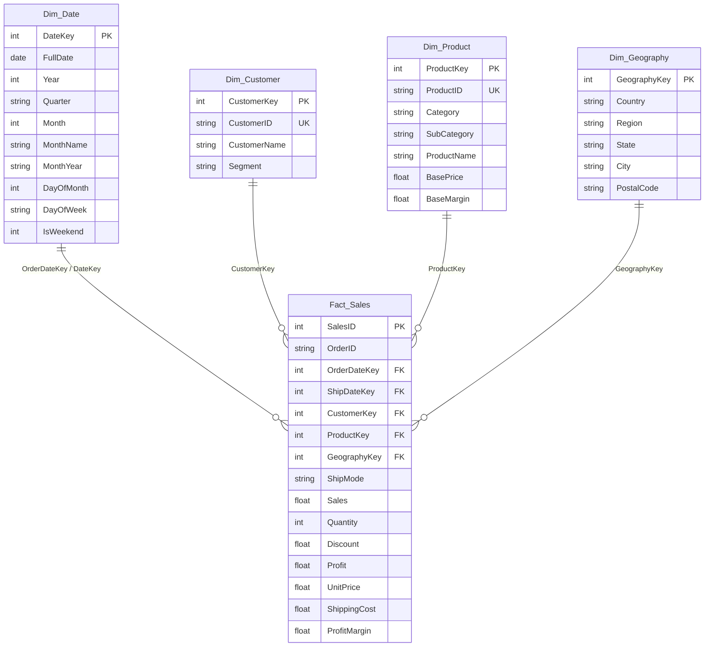

# 📊 Retail Sales and Profitability Analytics

[](LICENSE)
[](#sql-analytics-suite)
[](#power-bi-reporting-architecture)
[](#dax-measures-library)
[](scripts/generate_dataset.py)
[](https://myselfpalak.github.io/retail-sales-profitability-analytics/)

> **End-to-End Business Intelligence & Profitability Diagnostic Portfolio Project**  
> An enterprise-grade analytics project evaluating **\$5.89M in retail revenue** across **9,994 transactions** over 4 fiscal years. Built with Kimball Star Schema dimensional modeling, advanced SQL window functions, 25+ DAX measures, interactive Power BI reporting, and strategic C-suite business recommendations.

---

## 📌 Executive Summary

While top-line gross revenue demonstrated strong annualized growth (**+22.4% YoY**), operating profitability was lagging at **10.99%**, significantly trailing the corporate benchmark target of **15.00%**. This gap represented **~\$236,000 in uncaptured profit**.

This project provides end-to-end data diagnostics to uncover **where and why margin leakage occurred**, evaluate promotional discount elasticity, and model corrective actions.

### 🎯 Key Performance Indicators (Enterprise Totals)

| Metric | Enterprise Value | Benchmark / Target | Variance / Health |
| :--- | :--- | :--- | :--- |
| **Gross Net Revenue** | **\$5,892,311.06** | \$5,500,000.00 | 🟢 **+7.1% Ahead of Plan** |
| **Operating Net Profit** | **\$647,592.81** | \$825,000.00 | 🔴 **-\$177.4K Behind Target** |
| **Realized Profit Margin** | **10.99%** | 15.00% | 🟡 **4.01% Margin Deficit** |
| **Total Order Volume** | **9,994 Orders** | 9,500 Orders | 🟢 **Healthy Basket Volume** |
| **Average Order Value (AOV)** | **\$589.58** | \$550.00 | 🟢 **High Cart Spend** |
| **Average Promotional Discount** | **10.25%** | <8.00% | 🔴 **Excessive Promo Exposure** |
| **Projected Profit Uplift** | **+\$48,500.00** | — | 🚀 **Recoverable via Discount Caps** |

---

## 🏛️ Dimensional Data Model (Kimball Star Schema)

The analytical data foundation is structured as a Kimball-style Star Schema, separating business dimensions from transactional facts to maximize columnar compression and query performance.



---

## 🔍 Core Diagnostic Findings

### 1. Product Category Disparity: The "Tables & Bookcases" Drain
* **Technology** serves as the company's profit engine: **\$3.07M sales (52.0%)** delivering **\$844.9K profit (27.55% margin)**.
* **Furniture** is severely cash-negative overall: **-\$348.3K loss (-18.18% margin)**.
  - **Tables**: Generated **\$895.8K in sales** but incurred **-\$340.6K in net losses** (**-38.02% margin**) due to deep discounting (avg 15.1% discount across heavy freight items).
  - **Bookcases**: Generated **\$444.1K in sales** with **-\$67.3K in net losses** (**-15.15% margin**).
  - **Supplies** (Office Supplies): Lost **-\$15.6K** (**-17.83% margin**).

### 2. Geographic Vulnerability: Central Region Margin Collapse
* **South** (14.37% margin) and **East** (13.63% margin) are strong, healthy profit contributors.
* **Central Region** delivers an operating margin of only **4.81%** (generating 24.6% of sales but only 10.8% of profit).
* Root cause: Average discount in the Central region is **16.4%** (more than double the East's 7.8%).
* **Texas** is the company's single largest loss territory: **-\$25,368 in losses** (**-5.79% margin**).

### 3. Discount Sensitivity: The 20% "Tipping Point"
* **0% Discount (Full Price)**: Generates **19.38% profit margin** (zero loss-making orders).
* **1% - 15% Discount**: Generates healthy **12.86% profit margin** (3.4% loss rate).
* **16% - 25% Discount**: Margins compress sharply to **6.00%**.
* **> 25% Discount**: Profitability turns severely negative (**-22.4% to -69.1% margin**), with **68.5% of transactions producing net cash losses**.

---

## 💡 Strategic Business Recommendations

1. **Automated 15% Discount Ceiling on High-Loss Furniture**:
   - Mandate an automated ERP hard-stop on discounts exceeding 15% for Tables and Bookcases.
   - Require Regional Director sign-off for any commercial quote with discounts between 16% and 20%.
2. **Shift Sales Compensation from Volume to Gross Margin Contribution**:
   - Align Central region sales team incentives with net profit contribution rather than top-line revenue to stop price slashing.
3. **High-Margin Value Bundling**:
   - Discontinue discounting standalone desks/tables; instead, bundle them with high-margin **Technology Accessories (27.6% margin)** or **Peripherals (35.7% margin)** at full price.
4. **Projected Financial Uplift: +$48,500 Net Profit**:
   - Our SQL What-If simulation proves that capping discounts at 20% maximum recovers **+\$48,500 annually** with a **+76 bps margin expansion** while retaining >96% of order volume.

👉 *Read the full detailed strategic memo:* [reports/executive_business_memo.md](reports/executive_business_memo.md)

---

## 🛠️ SQL Analytics Suite

The repository includes 8 heavily documented, production-ready SQL scripts:

| Script | Purpose & Key Techniques |
| :--- | :--- |
| [`01_schema_definition.sql`](sql/01_schema_definition.sql) | DDL script with primary/foreign key constraints, B-Tree indexes, multi-dialect support. |
| [`02_etl_data_transformation.sql`](sql/02_etl_data_transformation.sql) | Automated data hygiene, NULL audits, referential integrity check, and analytical master view `vw_SalesAnalyticsMaster`. |
| [`03_kpi_executive_summary.sql`](sql/03_kpi_executive_summary.sql) | Executive financial metrics, AOV, loss-making transaction counts, and YoY trajectory. |
| [`04_category_subcategory_analysis.sql`](sql/04_category_subcategory_analysis.sql) | Category portfolio contribution, subcategory loss-maker identification, and Top/Bottom 10 product rankings. |
| [`05_regional_geographic_analysis.sql`](sql/05_regional_geographic_analysis.sql) | Regional scorecard, state rankings (`ROW_NUMBER`), and Central region diagnostic cross-matrix. |
| [`06_customer_segment_rfm.sql`](sql/06_customer_segment_rfm.sql) | Customer lifetime value, 5-tier RFM behavioral segmentation (`NTILE`), and Pareto 80/20 concentration analysis. |
| [`07_time_series_growth_mom_yoy.sql`](sql/07_time_series_growth_mom_yoy.sql) | Window functions (`LAG`), Month-over-Month % growth, 3-Month rolling averages, and quarterly seasonality. |
| [`08_discount_sensitivity_analysis.sql`](sql/08_discount_sensitivity_analysis.sql) | Discount bracket elasticity, loss tipping point, and What-If discount capping profit recovery model. |

### SQL Highlight: Month-over-Month & 3-Month Rolling Average Window Functions
```sql
WITH MonthlyBase AS (
    SELECT 
        d.Year, d.Month, d.MonthYear,
        ROUND(SUM(f.Sales), 2)  AS MonthlySales,
        ROUND(SUM(f.Profit), 2) AS MonthlyProfit
    FROM Fact_Sales f
    JOIN Dim_Date d ON f.OrderDateKey = d.DateKey
    GROUP BY d.Year, d.Month, d.MonthYear
)
SELECT 
    MonthYear, MonthlySales,
    ROUND((MonthlySales - LAG(MonthlySales, 1) OVER (ORDER BY Year, Month)) * 100.0 / 
          NULLIF(LAG(MonthlySales, 1) OVER (ORDER BY Year, Month), 0), 2) AS MoM_SalesGrowthPct,
    ROUND(AVG(MonthlySales) OVER (
        ORDER BY Year, Month 
        ROWS BETWEEN 2 PRECEDING AND CURRENT ROW
    ), 2) AS Rolling3MonthAvgSales
FROM MonthlyBase;
```

---

## 📈 Power BI Reporting Architecture & DAX Library

The Power BI implementation contains 25+ organized measures structured across 4 functional domains:

### DAX Measure Highlights

#### 1. Dynamic Pareto Cumulative Sales %
```dax
Cumulative Sales % = 
VAR CurrentSales = [Total Sales]
VAR ProductSummary = 
    ADDCOLUMNS(
        ALLSELECTED(Dim_Product[ProductName]),
        "@Sales", [Total Sales]
    )
RETURN
DIVIDE(
    SUMX(FILTER(ProductSummary, [@Sales] >= CurrentSales), [@Sales]),
    CALCULATE([Total Sales], ALLSELECTED(Dim_Product)),
    0
)
```

#### 2. Time Intelligence (Same Period Last Year & YoY Growth)
```dax
Sales Prior Year (SPLY) = 
CALCULATE([Total Sales], SAMEPERIODLASTYEAR(Dim_Date[FullDate]))

YoY Sales Growth % = 
DIVIDE([Total Sales] - [Sales Prior Year (SPLY)], [Sales Prior Year (SPLY)], 0)
```

#### 3. Loss-Making Transaction Ratio
```dax
Loss Making Orders Ratio % = 
DIVIDE(
    CALCULATE(COUNTROWS(Fact_Sales), Fact_Sales[Profit] < 0),
    COUNTROWS(Fact_Sales),
    0
)
```

### 4-Page Report Wireframes & Specifications
- **Page 1: Executive Overview** (KPI cards ribbon, Monthly sales/margin trend, Category split, Regional map)
- **Page 2: Product & Category Diagnostics** (Subcategory margin spectrum, Margin vs Discount scatter plot, Star products vs Drainers)
- **Page 3: Regional & Geographic Deep Dive** (State-level map, Central region diagnostic, Texas loss-maker analysis)
- **Page 4: Strategic Scenario & Discount Simulator** (What-if parameter slider, Projected profit recovery card)

👉 *Detailed build specifications:* [power_bi/wireframes/dashboard_design_specs.md](power_bi/wireframes/dashboard_design_specs.md)  
👉 *Step-by-step PBIX creation guide:* [power_bi/setup_guide.md](power_bi/setup_guide.md)  
👉 *Custom Power BI Theme JSON:* [power_bi/theme/modern_executive_theme.json](power_bi/theme/modern_executive_theme.json)

---

## 🖥️ Live Interactive Web Dashboard

To ensure hiring managers and recruiters can immediately interact with the dashboard without needing Power BI Desktop installed, this repository includes an interactive HTML5/Chart.js web application:

- **Launch:** Open `dashboard/index.html` in any browser!
- **Features:** Real-time filtering by Fiscal Year, Region, and Category; dynamic KPI re-calculation; responsive dark-themed charts; interactive diagnostic table with status alerts.

---

## 📂 Repository Structure

```
retail-sales-profitability-analytics/
├── data/
│   ├── raw/
│   │   └── superstore_retail_raw.csv         # Benchmark retail transactions source dataset
│   └── processed/
│       ├── dim_products.csv                  # Product hierarchy dimension
│       ├── dim_customers.csv                 # Customer profiles & segments dimension
│       ├── dim_geography.csv                 # Hierarchical geographic dimension
│       ├── dim_date.csv                      # Calendar & time intelligence dimension
│       └── fact_sales.csv                    # Line-item sales, quantities, discounts, profits
├── sql/
│   ├── 01_schema_definition.sql              # DDL schema definition with constraints & indexes
│   ├── 02_etl_data_transformation.sql        # Data hygiene, audit checks & master view
│   ├── 03_kpi_executive_summary.sql          # Revenue, profit margin %, AOV, order volume
│   ├── 04_category_subcategory_analysis.sql  # Portfolio contribution & loss-maker isolation
│   ├── 05_regional_geographic_analysis.sql   # Regional scorecard & Central region diagnostic
│   ├── 06_customer_segment_rfm.sql           # Customer RFM segmentation & Pareto analysis
│   ├── 07_time_series_growth_mom_yoy.sql     # Window functions (LAG, MoM, rolling averages)
│   └── 08_discount_sensitivity_analysis.sql  # Discount elasticity & What-If profit simulation
├── power_bi/
│   ├── dax_measures/
│   │   ├── 01_core_kpis.dax                  # Base sales, profit, margins, basket size
│   │   ├── 02_time_intelligence.dax          # YTD, MTD, SPLY, YoY growth measures
│   │   ├── 03_profitability_diagnostics.dax  # Negative margin ratios & discount leakage
│   │   └── 04_dynamic_rankings.dax           # Dynamic rankings, Pareto 80/20, KPI colors
│   ├── theme/
│   │   └── modern_executive_theme.json       # Custom executive palette for Power BI
│   ├── wireframes/
│   │   └── dashboard_design_specs.md         # Visual-by-visual layout and configuration
│   └── setup_guide.md                        # Step-by-step PBIX building tutorial
├── dashboard/
│   ├── index.html                            # Interactive browser-based BI dashboard
│   ├── styles.css                            # Modern glassmorphism executive styling
│   ├── app.js                                # Chart.js engine with interactive filters
│   └── data.json                             # High-performance summary data payload
├── reports/
│   ├── executive_business_memo.md            # Strategic executive memo & 90-day roadmap
│   └── resume_project_bullets.md             # Resume bullets & STAR interview guide
├── scripts/
│   ├── generate_dataset.py                   # Data generator and SQLite database loader
│   └── run_sql_benchmarks.py                 # Automated query benchmark and verification runner
├── retail_analytics.db                       # Standalone SQLite analytical database
├── LICENSE                                   # MIT License
├── README.md                                 # Project documentation
└── .gitignore                                # Git ignore configuration
```

---

## 🚀 How to Run Locally

### 1. Clone the Repository
```bash
git clone https://github.com/myselfPALAK/retail-sales-profitability-analytics.git
cd retail-sales-profitability-analytics
```

### 2. (Optional) Regenerate Datasets & Database
```bash
python3 scripts/generate_dataset.py
```

### 3. Run the Automated SQL Test Suite
```bash
python3 scripts/run_sql_benchmarks.py
```
*Expected output: `SQL Benchmark Summary: 43/43 statements succeeded.`*

### 4. Launch the Interactive Dashboard
Simply double-click `dashboard/index.html` or run:
```bash
open dashboard/index.html
```

---

## 💼 Resume & Interview Assets

Looking to highlight this project on your resume or prepare for a BI / Data Analyst interview?
Check out [`reports/resume_project_bullets.md`](reports/resume_project_bullets.md) for:
- Pre-written quantitative resume bullet points for Data Analyst, BI Analyst, and Analytics Engineer roles.
- Complete STAR-format behavioral interview story.
- Technical interview questions and answers on Star Schema modeling and DAX context transition.

---

## 👤 Author
**Palak**  
*Data & Business Intelligence Specialist*  
*Specializing in SQL, Power BI, Dimensional Modeling & Commercial Strategy*
